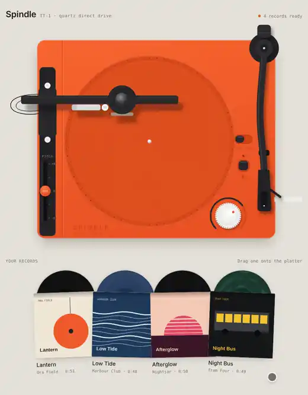

# Vinyl Turntable interaction

A playable top-down turntable with a stack of records beside it. Pull a record out of its sleeve, drop it on the platter, tap the tonearm and it plays. Ride the pitch fader, scratch the grooves, lower the dust brush, then lift the record off by its label and slide it back into its sleeve.

<p align="center">
  
</p>

<p align="center"><a href="docs/demo.mp4">Watch as a video</a></p>

## Interactions

- **Record stack.** Each record pokes out of its sleeve and slides further out on hover. Drag it onto the platter, or tap the sleeve to have it placed for you. Dropping a new record sends the current one back to its own sleeve.
- **Lift a record.** Grab it by the label to pick it up. Let go over the platter to put it back, anywhere else to return it to its sleeve.
- **Tonearm.** Drag it anywhere onto the grooves to drop the needle there. Tap it at rest to play from the start, tap it while playing to send it home. At the end of the side it rides the locked run-out groove, then returns and stops the motor.
- **Platter.** Start/stop spins up and down with inertia, so the music bends in and out of pitch. Hold or drag the grooves to slow or push the record by hand.
- **33 / 45.** Plays the record at the other speed.
- **Pitch fader.** ±8 % with a centre detent.
- **Strobe dots.** Stand still only at true speed and drift when you ride pitch.
- **Quartz-lock LED.** Blinks while the platter finds its speed.
- **Dust brush.** Tap the brush arm to lower it. Surface noise fades while it rides the record.
- **Volume wheel.** Drag, scroll or use the arrow keys.

Every control is keyboard reachable: Tab to it, then Enter, Space or the arrow keys.

## How it works

- **Music.** The four records (*Lantern*, *Low Tide*, *Afterglow*, *Night Bus*) are original pieces synthesised in the browser on load with an `OfflineAudioContext`. Playback runs the rendered buffer at the platter's real speed, which gives the spin-up bends and hand scratching for free. Crackle and the mechanical clicks are generated too, so there are no audio files.
- **Artwork.** Record faces, labels and sleeve covers are painted once to canvas.
- **Rendering.** React renders the SVG deck and the stack once. A small engine (`src/lib/deck.js`) runs the physics and writes the moving parts straight to their elements every frame. React only re-renders for what it shows itself, such as which record is on the platter.

```
src/
  App.jsx                  page layout, pressing status
  components/
    Turntable.jsx          the SVG deck
    deck/                  Platter, Tonearm, LeftRail (brush + pitch), Controls
    RecordStack.jsx        sleeves you pull records from
    FloatingRecords.jsx    the record in your hand or in flight
  lib/
    deck.js                engine: motor, tonearm, needle, gestures, per-frame drawing
    audio.js               live playback, crackle, deck sounds
    music.js               synth kit and one arrangement per record
    artwork.js             record faces, sheen, sleeve covers
    records.js             the four records
    geometry.js            deck coordinates and tonearm maths
```

## Tech stack

- React 19
- Vite 8
- Tailwind CSS 4
- Web Audio API (`OfflineAudioContext`, `AudioBufferSourceNode`), no audio files
- Canvas for record and sleeve artwork, inline SVG for the deck
- `requestAnimationFrame` physics, no animation library

## Run

```bash
npm install
npm run dev
```

Sound starts after your first tap, as browsers require.
